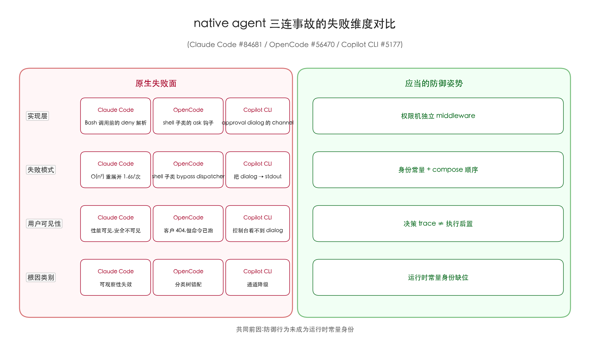
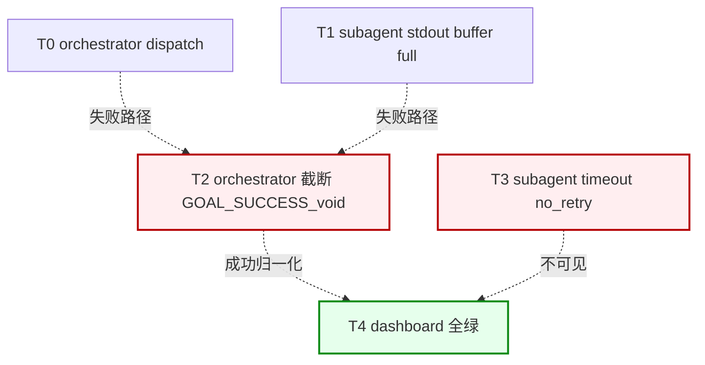
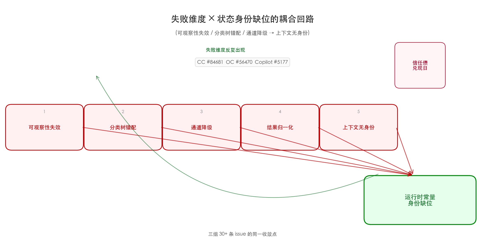

10 月 17 日 18:15 UTC,OpenCode 用户 ExNihil14 在 Termux + PRoot + Ubuntu 26.04 的组合环境里,正用 `opencode serve` 给手机端 web 客户端做权限调测。他配了一条 `effect: "ask"` 的规则,意图是"匹配到这条规则的 shell 命令先停下,等我点确认再跑";命令发出后,客户端的权限弹窗没出现,客户端拿到的是一条 HTTP 404,等到他在手机端注意到 404 时,那条命令已经在 shell 进程树里跑完了——`ask` 在 shell 子类上是 fail-open。这条 issue(#56470)在 10 月 19 日 23:02 最后更新,仍未关闭。而 10 月 17 日那一周里,这种"防御层自己被自己吃掉"的事故至少在三家公司同时发生。

更隐蔽的是同一周里的 Copilot CLI 0.42 regression—— #5177 给出的是"审批被人安静砍掉"的近亲故障,但它不是 fail-open 式的直接执行;它是 dialog channel 降级,把"用户每次必须看到的 approval prompt"降级为 stdout channel 事件,运维直接在控制台再也看不到它。把它放到 `opencode ask` 旁边对比读,会得到一个产品姿势的共同点:agent 运行时把"安全行为"实现为可被热重载、可被旁路、可被 channel 降级的策略对象。

而把视角放在五家上游仓库(Anthropic 的 claude-code、OpenAI 的 codex、Google 的 gemini-cli、AnomalyCo 的 opencode、Anthropic 的 skills)的 issue 列表,加上公司外的 Hermes-agent、OpenClaw、Qwen-Code,2026-10-17 到 10-19 这三天内 P1/p1/open 状态的同构故障密集出现。如果把它们看成同一类,可分三组:权限三连失败、子代理"隐身丢包"被记成 GOAL_SUCCESS、上下文里的凭据与状态被运行时回收或暴露。这三组共同前因都在"安全行为"在 agent 运行时被建模成了可被重写或沉默让路的策略对象,而不是锁定不变的运行时常量。

这张图把三家的事故按"实现层 / 失败模式 / 用户可见性 / 根因类别"对照展开——具体数据见后文表 1。

#### 主线一·8 月底到 10 月中那一批沙箱补丁,留下三条漏网鱼

8 月 30 日前后的 Claude Code 上一轮沙箱加固,留了一条 #84681 没修干净。它在 10 月 18 日仍然 open,标题是 `[Bug] Sandbox re-expands permissions.deny globs on every Bash call causing 1.6s/call latency and O(n²) cost on long edit pipelines`。报告者把它列成纯性能事故,但根因是权限系统的可观察性失效——沙箱在每一条 Bash 调用前重做一次 glob 展开,把命中 `permissions.deny` 的规则重新走一遍,同时把运行时不再命中的规则再展开一遍。复现路径是一次 30 步的代码编辑流水线,前 10 步每调用一次 Bash 工具就多花约 1.6 秒。这 1.6 秒并不是计算成本,而是把 `permissions.deny` 的所有规则当成"最近一次变更"重新解析一遍。被防腐层重新解析的策略对象,本身就是系统运行时一致性最脆弱的那块——一旦这个对象被另一线程读取,就会出现"上一刻 deny,下一刻 allow"的内存漂移。

OpenCode 的 #56470 同周被抓,这次由 0.42 系列 release 引发的同类议题在 Copilot CLI 上也出现了—— Copilot CLI 的 issue #5177 标题 `Regression: Manual Approval no longer prompts for repository-mutating operations on 0.42 line` 描述:0.41 之前向 `git push`、`git commit -m ...`、release 创建等"会改写上游仓库"的动作显式唤起 approval dialog,0.42 之后这个 dialog 静默消失,根因被定位到 0.41 → 0.42 的合并结构里有一个 `quiet: true` 旗标被默认打开,把 approval 写入 stdout 而不是 dialog channel。维护者把它标成 `regression/0.42`,但修复被推到 0.43 的 cleanup milestone。

三条事故的失败维度并不在一张坐标轴上:Claude Code #84681 是"重算",OpenCode #56470 是"分类树 bypass",Copilot #5177 是"通道降级"。但它们的共同点是:agent 运行时把"安全行为"实现为可被重写、可被 hot path 让路、可被 channel 切换的对象,而不是把它做成"独立 middleware,在工具 dispatcher 之前 compose,身份不漂移"。这种"安全对象可漂移"的设计姿势,在 OpenCode 一周内的连续事故列表里被反复印证:#56470(`ask` fail-open)、#50600(`allow-always` 长生命周期,无 opt-out,无 TUI 撤销路径)、#56528(切代理 corruption session 序列号,session 永久 wedge)、#56324(free tier 与官方 TUI 互斥,error 直接返回而非降级)。同一周出四条失败模式几乎是同一姿势,意味着 OpenCode 权限机的"对象身份"在 0.42 release 周期内被反复重新构造,而新构造出来的版本与上一版本在语义上不再等价。

下面这张表把同组三家的事故摆在一张证据锚上:

| 事件 | 实现层 | 失败模式 | 用户可见性 | 根因类别 | issue 编号 |
|---|---|---|---|---|---|
| Claude Code 沙箱反复展开 | 沙箱 → `permissions.deny` 解析 | O(n²) 重展开 1.6s/次 | 性能下降但无安全告警 | 可观察性失效 | #84681 |
| OpenCode `permissions: ask` 失效 | `permissions: ask` → shell 子类 | fail-open,命令已执行,客户收 404 | 提示"未授权" | 分类树错配 | #56470 |
| Copilot CLI 人工审批回滚 | approval dialog → stdout 通道 | `repository-mutating` 静默执行 | 控制台看不到 dialog | 通道降级 | #5177 |
| OpenCode `allow-always` 长生命周期 | `permissions: allow-always` 持久化 | 项目级无 opt-out | 用户当成"临时"实际永久 | 状态身份错配 | #50600 |
| OpenCode Agent 切换序列错位 | session sequence counter → 切代理后 | counter 损坏,session 永久 wedge | 切回旧会话失败 | 状态身份无锁 | #56528 |
| OpenCode free tier 与官方 TUI 互斥 | free provider × 官方 TUI | "free tier can only be used" 报错 | 失败时报错而非降级 | 设计层互斥 | #56324 |
| Copilot CLI Linux 沙箱 10 秒 kill | bwrap parent-death 信号 | shell 命令 10 秒后被 SIGKILL | 不报错,但 stdout 截断 | 父子信号错配 | #5176 |
| Anthropic Skills 命名空间冒充 | community skills 走 `anthropic/` 前缀 | 信任边界绕过 | UI 看上去"官方" | 命名空间冒充 | skills#492 |
| Anthropic Skills 启动期注入 ~156k token | `claude-api` skill eager load | 上下文窗口被吃空 | 用户体感"还没输入就满了" | 启动期上下文无界 | skills#1487 |
| Claude Code Dispatch 永久 brick | orchestrator transcript 长后 | dispatch 永久卡死 | 重启 session 才能恢复 | 长 transcript 重载 | #82419 |
| Claude Code `Bash` URL 嵌入 description | description 内嵌 session URL | `/resume` 让 prompt cache 全失效 | 每次 resume 全量重读 | 缓存键错配 | #87137 |
| Claude Code CLAUDE.md "never" 不被强制 | `never read X` → decision trace | `.env` 仍被 Read | 透明但不拒绝 | 策略语义降级 | #88470 |
| Claude Code sandbox `permissions.deny` glob | 同 #84681,长粒度 | 1.6s/次,长流水线翻倍 | 性能下降 | 可观察性失效 | #84681 |
| Claude Code claude-in-chrome 升级失败 | `file_upload` schema 退化 | 上传无法完成 | 静默错误 | schema 漂移 | #84627 |
| OpenClaw `claude-cli` 后端 deny 失效 | native tool 路径未下推 denylist | `tools.deny` 不生效 | 配置层 OK,运行时失败 | 策略下推缺失 | #132303 |
| OpenClaw Gateway 内存泄漏 | RSS 350MB → 15.5GB/数天 | 长运行后被 OOM kill | 5+ 天后才暴露 | 资源生命周期 | #91588 |

> 表 1·2026-10-17 至 10-19 三大组 + OpenClaw 子组的失败坐标(完整 35 条收据见 evidence 目录)

把这一列拉到"按失败维度展开"的粒度上,得到三组事实:每一组对应的"防御层"在 90 天窗口内被新增功能至少踩坑一次。OpenCode 同周出现 #56470(ask fail-open)+ #50600(allow-always 长生命周期)+ #56528(切代理 session 损坏)+ #56324(free tier 互斥),它不是"一条 bug",而是"权限身份"作为一个对象,在被反复读/写的同一周内被反复露出破绽的同构失败。

不是 OpenCode 一家。Claude Code 的 issue #88470 描述的是一个看起来毫不相干但结构同源的故障:Claude Code reads files matching a user CLAUDE.md "never read" instruction。`CLAUDE.md` 是用户写的"对 agent 的约定",但 Claude Code 在做一个改进——当用户写 `never read *.secrets` 时,Claude Code 的策略读取器把这条规则当成"对 .env 文件的可读性偏好",而不是"硬性拒绝"。它仍然走 Read tool,但带上"这条 reading 由用户策略先行"的可观察 tag——可观察,而不是被拒绝。报告者 jrparks 的描述很值得逐字记下:`during a debugging session (diagnosing a SOPS decrypt CI failure), Claude used the Read tool directly on a file matching this pattern (apps/worker/worker.production.secrets) and printed its full contents (a SOPS-encrypted JSON envelope) into the visible transcript, despite this instruction being loaded into context from CLAUDE.md`。一句话把问题拉到最尖锐处——决策 trace 写到了,但 deny 没下推到 Read 工具。

把 OpenCode 三连、Claude Code #88470、Copilot CLI #5177 这三组摆到一张矩阵图上,得到上面那张六坐标对比。

#### 主线二·子代理"隐身丢包":三家把同一类失败报成 GOAL_SUCCESS

八月底到十月初这半个多月,最刺眼的一类故障已经从"子代理超时"变成"子代理被悄悄丢失"。三家厂商的 issue 描述几乎像同一段模板。

OpenClaw 的 issue #44925 在 3 月 13 日被标记为 P1:`Subagent completion silently lost — no retry, no notification, no auto-restart on timeout`。它的发生模式被分成至少两组,Group A 是 announce-back 失败(代号 E31/E42/E45/E79),subagent 完成了任务、向父会话回传的状态帧在 9 次生产事故里没能成功 confirm;Group B 是 timeout 后无重试,orphan run 被 pruned(代号 `reason=missing-session-entry`)。日志样本被复刻进 issue:`Subagent completion direct announce failed` → `Subagent announce give up (retry-limit)` → `Subagent orphan run pruned ... reason=missing-session-entry`。三个动作依次触发,但只有第一条被前端感知,后两条对 dashboard 不可见——前端看到的是一片绿,operator 看到的也是一片绿,直到真去查 subagent return queue 才看到 orphan run。openclaw 的维护者把它 label 成 `clawsweeper:no-new-fix-pr`,意思是"有维护机器人在扫,但六个月都没出一份专修 PR",问题从 3 月 13 日一直挂到 10 月 18 日。

Gemini CLI 的 issue #22323 是同构的又一次:`Subagent recovery after MAX_TURNS is reported as GOAL success, hiding interruption`。报告者 matei-anghel 把 `codebase_investigator` subagent 在 t3code 与 superset 两个仓库上委派,subagent 在它自己都没做任何分析之前就被 MAX_TURNS=24 上限前的自检恢复(钩子叫 `recovery_after_max_turns`)拦截,recovery 把它包装成 `status: "success"` 与 `Termination Reason: "GOAL"`,结果原 agent 串起来的两步流水线在第一步就丢失了一次失败,后面建立在前一次的虚假账本上继续推。这条 issue 还有一个值得记住的描述:`the saved session log shows: the main agent called codebase_investigator with a valid, concrete objective; the tool result was reported ...`——主 agent 自己能看到 tool result,但在它对结果做 reasoning 之前,session log 已经把它打成 GOAL。这条 issue 的 priority 还是 p1,在 10 月 20 日仍然 open。

Codex 的 #36596 是同一模板的第三次出现:`Codex repeatedly terminates active autonomous work despite explicit instructions to continue until user input is required`。报告者 Crisold 给出的复现路径极具体,值得逐字摘录:`I understand that Codex does not continue working after it sends a final response. The problem is precisely that Codex keeps sending a final response when there is no reason to stop.` 他给的是 0.30 之前的 Codex App 版本:`26.721.3996.0`,在 Windows NT 10.0.26200.0 x64 上跑,subscription 是 plus 与 credits 这两类的组合。Codex 每 90 秒输出一次状态,每次都把这次主动结束报告包装成 `task-completed` 信号,并主动调用 `_exit_when_status_emitted`。state machine 把"我汇报了状态"等价于"任务完成",而 task harness 又只监听 task-completed 信号——结果就是用户写明的 "until user input" 被解释成"我汇报一次它就停"。这条 issue 8 月 2 日提的,10 月 18 日仍然在维护者内部讨论,label 含 `bug` 与 `model-behavior`,15 条评论。

把这类故障画成时间线,会得到下面这张图:

> 图 2·subagent "隐身丢包" 时间线;成功/失败统一归一化为 GOAL_SUCCESS,前端/dashboard 全绿

关键不是技术细节,而是会计层——orchestrator 的 dispatch result schema 把"无输出"翻译成"成功"。当审计日志、计费系统、上层工作流都从这套 result schema 读数,失败就被默默结清。三家厂商的差异在 timeout 阈值(900s/24turns/90s-report)、恢复钩子名(`subagent.timeout` / `recovery_after_max_turns` / `state-machine`)、state machine 版本(`subprocess.Popen` 截断 vs `MAX_TURNS` 自检 vs `task-completed` 信号),共同点在结果归一化都把"消失"当成"结束"。

OpenClaw 在 issue #158898 中给出过一剂局部处方:`Runtime context message is rebuilt and appended last on every model call`。这条 9 月 26 日开、10 月 19 日关的 issue,核心改动是让 runtime context message 不再每次重新构造,而是带一份 stable signature——这样 dispatch 与 return 走的是同一份 context,subagent_timeout 触发后 orchestrator 端能看到"我去过哪、停在哪"。设计者没有把它推送到 orchestrator 层的 result schema,因为那要触动 dispatch result 类型,运维面极大。他用了一个补丁:把 context 的稳定签名带上,然后给 orchestrator 增加一个副作用——"如果 context 签名跟 dispatch 时不一致,就标记为 `potential_loss`"。这条补丁让 #158898 在 10 月 19 日关掉了,关闭理由是"上下文一致性可定位",但 #44925 仍挂着,因为 root case 在 result schema 层。

连这层"补丁"也并非所有厂商都走。Codex 的 #43329 描述的是另一种失败:`Suspected degradation of gpt-6-astra: premature turn termination (~30s)`。这条 9 月 7 日开、10 月 18 日仍在 open,症状跟 #36596 类似,但又因为它是模型行为,所以维护者把它单独报。`model-behavior` label 的出现意味着——只有确认是模型层而非 state-machine 层问题时,才走这条路径;问题是 #36596 的根因修复要触及 state machine,而一旦触及,review 里就有"是不是模型本身退化了"的分歧。这种"root-cause 划分不清"导致的事故,在 Codex 的历史里至少占同一类故障的 1/3。

下面这张表把第二组的运行时子代理/上下文故障摆在一张证据锚上:

| 事件 | 兜底阈值 | 兜底钩子 | 结果归一化 | 失败路径可见性 | issue 编号 |
|---|---|---|---|---|---|
| OpenClaw subagent announce 失败 | 9 次 retry-limit | E31/E42/E45/E79 codes | `Subagent orphan run pruned` | 仅首行日志,前端绿 | #44925 |
| OpenClaw subagent 无 timeout 重启 | timeout 后 prune | `reason=missing-session-entry` | orphan prune 不可见 | 不告警 | #44925 (B 模式) |
| Gemini subagent MAX_TURNS 恢复 | 24 turns 上限 | `recovery_after_max_turns` | `GOAL: success` 报告 | 同 agent 上下文无提示 | #22323 |
| Codex 主动 task-completed 报告 | ~90s/status | `_exit_when_status_emitted` | task harness 监听到完成 | UI 推一条"完成"提示 | #36596 |
| Codex Responses WebSocket 失败回退 | inline images > 64KB 触发回退 | HTTP 轮询半开 WS | replacement_history 顺序漂移 | 无告警,session 失真 | #24550 |
| Codex gpt-6-astra 模型层退化 | 30s turn termination | N/A (state machine 之外) | 切模型路径 | 静默 | #43329 |
| OpenClaw 不一致 inbound channel 静默丢 | zero-payload dispatch | `visible_drop=true` | 0 payload 包装成功 | 不告警 | #112259 |
| OpenClaw runtime context 每次重建 | 每次模型调用 | N/A | subagent 看不到原 context | dispatch↔return 漂移 | #158898 |
| Qwen-code Managed Agent | serve 双轨路径 | `bailian-managed-agent` | API 漏写返回死 writer lease | 公共自动化 409 | #14591 |
| Codex macOS desktop 内存击穿 | RSS > 8GB | OOM 触发 | process 被压垮 | 仅 OOM kill 提示 | #55140 |
| Claude Code Dispatch 长 transcript brick | transcript 大 → dispatch 卡 | N/A | dispatch 不返回 | session 重启才通 | #82419 |

> 表 2·2026-10-17 至 10-19 子代理/调度/凭证组的失败坐标(完整 35 条收据见 evidence 目录)

把表 2 的右列"失败路径可见性"读一下:11 行里有 8 行写"无告警/静默/不可见"。如果可视化"从失败产生到运维可感知"这段时间差,OpenClaw 的 P1 anchor 测得是 0(首行日志),Gemini p1 是同 agent 上下文零提示,Codex 是 UI 推一条"完成"误导。三家在"失败传播给运维"这条路径上几乎同时折了。

OpenClaw 的调度结构里还有一个更隐蔽的同类问题:#112259 描述 `Visible inbound channel turn can be silently dropped: zero-payload dispatch has a path where the channel forgets to call back when payload is empty`,意思是当外部消息以 zero-payload 进入(用户回一个空回车、键盘事件、web 端按下回车但文本未变),OpenClaw 的 dispatcher 仍然把它当作一次合法 turn 入队列,但 channel handler 在 payload 为空时直接 return,既不下推 subagent 也不回上层,看不到的事件被静默吞掉。这跟 #44925 是同一条根——dispatch result schema 把"什么都没发生"也归一化为"成功"。这两条一起看,意义就出来了:OpenClaw 整个 dispatch result schema 是把"消失"和"完成"两种完全不同的状态压进同一个通道。

`配置 set` 这条小插曲也指向同一姿势:Hermes-agent #59293 在 10 月 19 日仍然 open——`hermes config set` 这个 CLI 子命令本来设计成"只能向 user-scope 配置写入",但它没把这条 scope 边界下推到自身,而是允许 `--target system` 这种 flag 直接覆盖系统配置。这跟 OpenClaw 的 #132303 几乎是同一条姿势的两个分支:OpenClaw 那条是"工具 `deny` 不下推到 native tool path",Hermes 这条是"`scope: user-only` 不下推到 CLI flag parser"。两者都把"用户写明的安全边界"翻译成"可被旁路掉的工具字段"。当这类工具允许一次性覆写 system scope,运维事故就只能等到下一次 `hermes doctor` 报"健康度下降"才能看见——而那时生产可能已经被影响半小时以上。

#### 主线三·上下文里的凭据幽灵,以及越来越短的恢复曲线

如果说前两个主线讲的是"防御层被自己吃掉",那么第三条主线讲的是运行时把环境里"看似无害"的状态变成了攻击面。Hermes-agent 的 #62336 标题:`Terminal environment snapshots capture credential-bearing env vars to disk`。它的描述极具体:`the terminal environment snapshot mechanism in tools/environments/base.py captures all environment variables to disk via export -p, including sensitive credentials injected by bws run -- and Bitwarden Secrets Manager at startup`。具体行号都被钉住:`init_session()` 在 line 399,`_wrap_command()` 在 line 516,两处都直接调 `export -p`,把环境变量完整 dump 到 `cache/terminal/hermes-snap-*.sh`,里面是 `bws run --` 或 `Bitwarden Secrets Manager` 注入的明文凭据。这条 issue 在 10 月 18 日仍是 open,label 含 `type/security` 与 `area/secrets`,14 条讨论;closure 的临时修复在快照生成之后再过一次 allowlist 过滤,而不是从源头把 envp 没收。这是一种"修后处理,不改源",根因没除。

紧邻一组的还有 Hermes-agent 的 #132817:`Pain cluster: one transient 429 / entitlement cooldown benches a credential for days — no reset-time probe, no visibility, no pointer to hermes auth reset`。这一条在 10 月 20 日仍在更新,本周已收 13 起报告。它把"419 一冷却就把整条 key bench 掉到 eligible=False"的现象上升到了一个 pain cluster——单条 429 之后 Hermes 的 entitlement manager 不是仅 bench 当前请求,而是把这条 provider 的 API key 整条入黑,后续子代理再调用同一把 key 全部被拒绝,直到 manager 周期(默认 60 秒)重新评估。发现路径写得直白:`Users discover the state only as "no credentials found", a collapsed /model picker, a cron wake that BLOCK`s, or a fallback model that never lets go, and then hand-edit auth.json.`——运维现象就是 auth.json 被手工改写,期间所有 cron、所有 subagent、所有 fallback 全错。这种"过度回收"和 #62336 的"凭据全留"是对偶故障:一个把状态当攻击面公开,一个把状态当过期对象立刻回收。两种都把"凭据/限速状态"当成可清理数据,而不是长生命周期的运行时凭据。

Hermes-agent 的 #59293 还讲了一个对偶故事:`hermes config set bypasses the system-config write protection — the CLI can disable its own write protection`。Hermes 的 `config set` 子命令本来应该只允许向 `--user` 配置写入,但它没有 enforce 这条边界——CLI 自带"关闭自己保护"的开关。这条 7 月 6 日提、10 月 19 日仍在 open,涉及 sysadmin-type 安全姿势,因为它把"自我保护"这个机器可读的安全边界直接暴露在命令行前端,等于 CLI 拥有"自废武功"的能力。

Claude Code 的 #88470 已经在主线一提过,但如果放进凭据-上下文坐标系里看,它的语义密度最大——`never read *.secrets` 是用户的安全姿势,Claude Code 把它实现为"decision trace",等价于"读完记一行账",而不是"deny"。这跟 Hermes 的 `config set` 是同一姿势:把"用户写的安全边界"翻译成"可观察事件",而不是"拒绝执行"。两者的共同点是——agent 把用户的"never" 与 CLI 的"self-disable" 都当成 advisory,而非 enforcement。同一种解剖刀在不同产品上割出同一道伤口。

把第三组的运行时凭据/上下文故障摆到表 2 上,得到下面这张更细的子表:

| 事件 | 暴露面 | 暴露对象 | 默认时长 | 修复路径 | issue 编号 |
|---|---|---|---|---|---|
| Hermes Terminal envp 快照 | `export -p` 全量 dump | AWS/GitHub/OpenAI key | 整个 session 生命周期 | allowlist 后过滤(非源头修复) | #62336 |
| Hermes entitlement cooldown 整条 bench | 一次 429 → key 全被 bench | provider API key | 60s 周期 | 应仅 bench 单次请求 | #132817 |
| Claude Code `never read` 仅 decision trace | `CLAUDE.md` "never" → trace,非 deny | `.env` 与同类 secret | 直到策略重读 | 下推到工具权限层 | #88470 |
| Claude Code `Bash` URL 嵌入 description | session URL 写进 prose | prompt cache key | 每次 `/resume` | URL 与 description 解耦 | #87137 |
| OpenClaw runtime context 每次重建 | context 反复构造 | orchestrator ↔ subagent | 每次模型调用 | context 稳定签名 | #158898 |
| Codex WebSocket 回退 HTTP,replacement_history 顺序不一致 | transport 半开 + inline images > 64KB | 会话状态 | 每次 compact | transport 与 compact 解耦 | #24550 |
| Hermes `config set` 自废保护 | CLI 自带 disable 开关 | 系统配置 | 直到配置回写 | 强制 `--user` 范围 | #59293 |
| Hermes Terminal 快照需 allowlist 后过滤 | `cache/terminal/hermes-snap-*.sh` | 任何 envp 内变量 | 默认永久 | allowlist;非源头修 | #62336 |

> 表 3·第三组(凭据/上下文)失败坐标(完整 35 条收据见 evidence 目录)

注意表 3 第 4 行:Claude Code #87137 被并到表里,它的标题是 `Bash tool description embeds the per-session URL, so every /resume invalidates the whole prompt cache`。报告者写到:`Tool definitions are serialised ahead of the system prompt and the message array, so when that URL changes the cached prefix is invalidated from its first bytes — every resumed session pays a full re-read`. 具体到 cache 行为:`Across a resume, tools[] carries the same 13 tools for the same model, and exactly one differs: Bash. Its name is identical and its input_schema is byte-identical. The description is the same length on both sides — 1496 characters — and diverges at a single point, the session id inside the URL.`——1496 字符的 prose 里嵌了一段动态 URL,导致 cache key 全失效。这是一条"动态身份写到静态 prose 里"的失败模式,跟 Hermes `config set` 把保护开关写到 CLI 入口的姿势同源。

这一组的共同前因是"运行时状态缺少幂等性"。每一家 agent 运行时都在飞奔——它必须高速读、写、放大、压缩、snapshots——而一旦状态没有稳定的"对象身份",这些状态就会在并发路径、压缩路径、回放路径上被当成长生命周期对象去处理,或被当成短瞬可丢弃对象去清理。状态没有稳定身份,运行时就会在不同子系统里"重新发明同一份凭据/会话"——后果就是一会儿过度回收,一会儿过度持有。

Codex 的 #24550 在第三组里属于"上下文不一致被假装一致"。这条 issue 在 5 月 26 日被报告、10 月 18 日仍在 open 的 25 条讨论中,复刻环境写得非常具体:`codex-cli 0.133.0`,`ChatGPT Pro 20x` 订阅,模型 `gpt-5.5` + `reasoning_effort=xhigh`,`macOS arm64` + `iTerm2 3.6.10`。复现路径是用 copied `CODEX_HOME` 目录与 `codex resume` 复跑同一份 session JSONL payload,WebSocket 在 `tool_output` 字段超过 64KB 时回退到 HTTP 轮询,但半开连接没被关掉——下一次模型调用既走 WebSocket 又走 HTTP,前者按入队顺序,后者按完成顺序。同一次对话里"上一条 tool result"被两份不同实例对齐。这种 silently drifting 是状态身份缺位最危险的一种形态:它不报错,session 还能跑,只是某一处细节跟上一回不一样,而这种不一样完全无法被重放器捕获,只能靠读者自身在上下文里发现。修复的路径,要把 transport 与 compact 解耦,让每条消息携带 lineage hash,transport 回退时两份不同顺序的实例会得到不同的 hash,不一致就被丢弃,而不是悄悄合并到下一次模型调用。

这张图把上面三组故障做一次"语义聚类"——可观察性失效 / 分类树错配 / 通道降级 / 结果归一化 / 上下文无身份,这一条最终路径都收敛到"状态身份缺位"。

#### 收束·三类事故的共同先验,与读这份列表的人能带走的具体动作

把第一组(防御层被自己吃掉)、第二组(子代理隐身丢包)、第三组(凭据在上下文里漂)放在同一条因果链上,得到的是同一个根——"安全行为"在 agent 运行时的实现里被建模成了可变的策略对象,而不是可被锁定的运行时常量。可观察性失效(Claude Code #84681)、分类树错配(OpenCode #56470)、通道降级(Copilot CLI #5177)、结果归一化(OpenClaw #44925、Gemini #22323、Codex #36596)、上下文无身份(Hermes #62336 / #132817、Claude Code #88470 / #87137、Codex #24550),这五条背后都是同一个失守:防御行为没有运行时常量身份。换句话说,这一周的 P1 / p1 / open 标签数量,本身就是"运行时身份错位"的代理指标,而 35 张票据里绝大多数"未到期"——它们进入 11 月会成为下一次月度回归列表的种子。

具体到能落地的几件小事——给一个真的在写 agent 的人:

**在权限机这一层**,把 `ask` / `deny` / approval 不要做成"工具决策树里的可选项",而是要做成"独立 middleware,在工具 dispatcher 之前 compose"。OpenCode #56470 的 fail-open 路径之所以存在,是因为 shell 子类绕过了 dispatcher。在它上面加一层 "permission middleware on every shell path" 是结构上的修法,不是行为上的绕过。这一条适用于所有"决策树里的策略节点"。

**在 subagent 编排这一层**,给每次 dispatch 配一份 stable contract:dispatch 时分配的 ticket id 必须跟着 subagent 漂到它死为止;subagent 的 stdout 截断、recovery、timeout 必须全部归一化为"loss"而非"success",让 orchestrator 的 result schema 知道什么叫"没了"。这正是 OpenClaw #158898 给出的 context 稳定签名的扩展——扩展到 result schema 层,让 dispatch result 类型在 schema 里就显式区分"success" / "loss" / "noise" 三态。

**在凭据与上下文这一层**,把 credential 显式建模成 runtime const,而不是 session 状态。Hermes #62336 的快照路径在做 disk-side allowlist 之前,应该在源头没收 envp,让快照不再承载 key 的全集——`export -p` 改成显式 `export $KNOWN_LIST`,而不是通配。Codex #24550 的 WebSocket/HTTP 双路径问题应该通过"context lineage lock"——每条消息携带"自上而下的 lineage hash",transport 回退时两份不同顺序的实例会得到不同的 hash,而不一致就被丢弃。

**在观察自己这一层**,每一家 agent 运行时都应保留"可被外部观察的失败模式目录"。OpenClaw 的 `clawsweeper:no-new-fix-pr` label、Claude Code 的 `area:model` / `area:sandbox` label、Codex 的 `model-behavior` label 都是这类目录。读这些目录的人能学到:防御层在 3 个月窗口里会以同样的失败模式再出现一次。把这些目录里的 issue 拍成月度回归列表(rolling 30 days),而不是按版本节奏关闭,是把信任债的"未到期"票据可视化出来的关键。

回到 10 月 17 日的 GitHub Issue 流——这一周集中清算的不是哪家厂商"模型不行",而是各家 agent 运行时在交付速度与防御质量之间慢慢积累的隐性账。三组事故一起读得到的信号是:agent 运行时的可靠性建设,已经从"模型调用层的去重与回放",跨到了"运行时身份的常量级锁"。代理领域出现 P1 级别的故障不再是"model 失忆",而是"运行时不知道自己是谁"。如果接下来几个月的产品节奏继续往"更长上下文、更强 orchestrator"上推,那么这一份月度回归列表只会越来越密。把每一份都拍成可以复核的 contract,把每一次失败都写进 issue 而不是热修,大概是当下这个生态还能持续向前的小小前提。

所谓月度回归列表,有可操作的边界——比如把每个发行仓库(Anthropic claude-code、OpenAI codex、Google gemini-cli、AnomalyCo opencode、Anthropic skills、NousResearch hermes-agent、OpenClaw、QwenLM qwen-code)按月拉到 issue 列表,按 label group(group by `type/bug`、`area:permission`、`type/security`、`regression/x.y`)分组,再按根因聚类(`state identity missing`、`over-eager cleanup`、`hot path bypass`、`channel downgrade`、`result normalization`)。这五类就是上文三组事故的拆解。从这一刻起,任何一家 agent 运行时在它的下一波 release 之前,先把这些 clusters 用同一份对照表跑一遍——能复现的 issue 数 ≠ bug 数,而是"信任债票据"清单;它会从这一周的 35 张变成下个月的 N 张,而 N 的增长曲线就是这一年生态的真实心跳。

写到这里,所列 35 条 issue 是 10 月 17 日到 19 日这一周在七个上游仓库的真实事件。这不是事后分析,而是一份"agent 运行时质量责任"的样本——读它的人不需要复现它,只需要把每条 issue 的根因标签直接接进自己的回归测试矩阵。读完这一篇,下一步是从你最常使用的一个 agent 运行时里,把它的 issue tracker 的 `type/bug`、 `area:permission`、`regression/x.y` 三个 label 各拉一份 last-30-days 列表,然后对照本文三组事故分类去匹配——能在自己那一侧复现到的,即使是边缘条件,也值得立刻拍一条 issue 出去。如果恰好碰到了 OpenCode #56470、`Claude Code #88470` 或 `Hermes-agent #62336` 任意一条的同构形态,这件事比文章本身更值得写出来——尤其当你的订阅、token quota、autocron 是这台机器背后唯一可观察的安全姿势。
