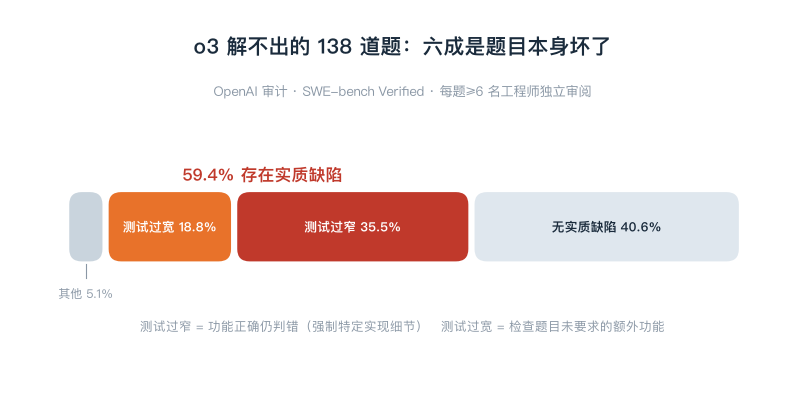
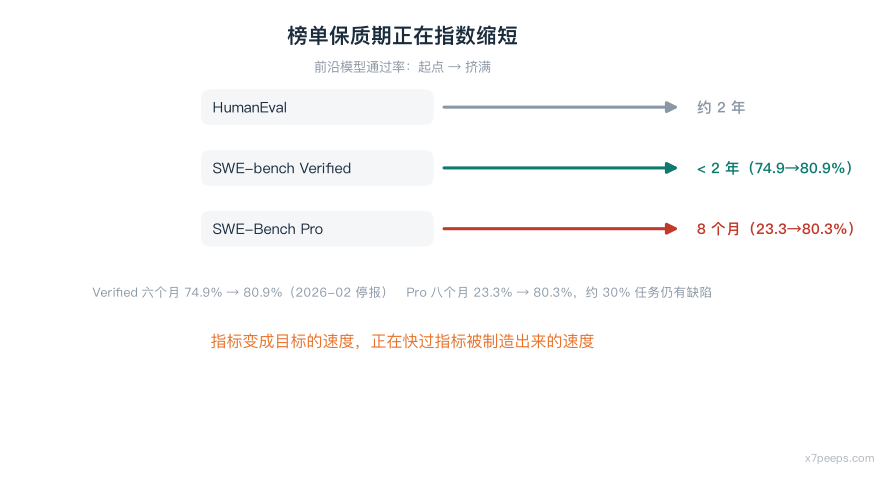
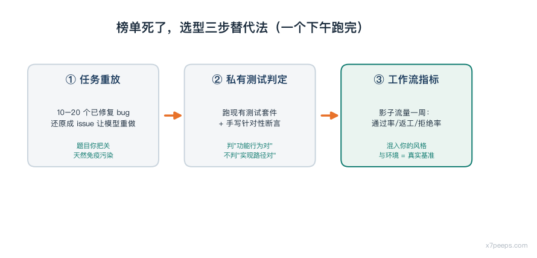

# SWE-bench 停报：模型解不出的题，一半是坏的

2026 年 2 月，OpenAI 做了一件没有开发布会、但比任何一次模型发布都更值得复盘的事：**SWE-bench Verified 分数不再出现在官方评测表里**。最后一份报告是 80.9%，六个月前同一条曲线还在 74.9%[1]。

不少人的第一反应是"OpenAI 不敢跑了"。这个因果搞反了。我的判断是：**停报不是榜单的失败，是榜单完成历史使命的收尾仪式**——而真正值得细看的，是 OpenAI 在停报前后自己交出的两份审计：一份关于题，一份关于污染。

## 一、先说反直觉的部分：解不出的题，不等于难题

OpenAI 的审计对象选得很聪明：不是全量 500 道题，而是 **o3 在 64 次独立运行里都没能稳定解出的 138 道题**——按直觉，这是"最难的部分"，是模型与人类差距的所在。每道题由至少六名有经验的工程师独立审阅，只要一人标记问题，就交给另一个团队复核[1]。

结果：**138 道里 59.4% 存在测试设计或问题描述上的实质缺陷**——足以让这些题对最强模型乃至人类都极难、甚至无法完成。不是"题目偏难"，是题目本身坏了：

| 缺陷类型 | 占比 | 意思是 |
|---|---|---|
| 测试过窄 | 35.5% | 功能做对了，但没猜中出题人指定的实现细节，照样判错 |
| 测试过宽 | 18.8% | 检查了题目从没要求的额外功能，做少了判错 |
| 其他 | 5.1% | 无法归入上述两类的判定问题 |

两个真实例子。一道 pylint 题，原始修复引入了 `get_annotation`，测试直接导入这个名字，但题目描述从头到尾没提过它——模型实现了功能，仍可能因为函数名没对上而挂掉。一道 sympy 题，原始 PR 修了 `nthroot_mod` 的三个独立 issue，描述只写了一个，测试却全查[1]。

这是我整篇文章最想让你记住的一件事：**当模型"解不出"一道题时，第一假设不该是"能力不行"，而是"这题可能没有唯一正确的答案"。** 榜单上那 20% 的"未解决部分"，相当一部分不是前沿边界，是数据质量的沼泽。

## 二、污染不是怀疑，是有证据的

比坏题更致命的，是第二层问题：训练数据污染。SWE-bench 的题目来自 12 个开源 Python 仓库的真实 issue，代码和修复 PR 全部公开——而这些仓库恰恰是模型训练数据里的常客。

OpenAI 没有停在"我们怀疑有污染"，而是拿出了两类证据。其一，前沿模型能复现 gold patch（标准答案），或逐字复现某些题目的完整描述。其二，一套自动化探针：把题目 ID、描述、gold patch 和 PR 测试交给模型，让它在十五轮对话里不断变换系统提示、前置补全和引导策略套取细节。结果 GPT-5.2 只拿到一小段描述，就输出了确切的 gold patch——准确的类名、方法名、新引入的提前返回条件；Gemini 3 Flash 只拿到题目 ID，也能逐字输出描述内容和校验用户名的正则表达式、改动的确切行号[1]。

最耐人寻味的一个细节：GPT-5.2 解开了 31 道被认定"几乎不可能完成"的题。其中一道 Django 任务，测试要求一个题目未提及的新参数 `edit_only`，而模型的思维链里出现了相关发布说明的信息，并准确指出该参数在 Django 4.1 引入——**它不是变强了，它是读过答案所在的页。**

OpenAI 也坦承：不能把每一分提升都归因于污染，污染贡献了多少分无法量化。但结论已经足够指导行动——**Verified 分数已不能可靠代表真实软件开发能力的进步**，这是停报的直接原因。

## 三、换新榜单也救不了：Pro 只撑了八个月

行业对"Verified 脏了"的标准反应是换更新的基准。SWE-Bench Pro 就是被寄予厚望的那一个：任务更长、更贴近真实 agentic 编码。然后 OpenAI 把它也审了。

公开子集 731 个任务，前沿模型通过率**八个月从 23.3% 冲到 80.3%**[1]。自动化流水线检查模型尝试记录与失败轨迹，标记 200 道问题任务（27.4%）；人工标注识别 249 道（34.1%），并由五名资深工程师独立评审、分歧升级调查。综合估计**约 30% 的任务存在缺陷**——测试过严强制实现细节、提示遗漏隐藏要求、覆盖不足让不完整修复过关、提示与测试直接相反[1]。

把两个基准的寿命曲线放在一起，才是真正的行业信号：Verified 从 2024 年成为标准指标到 2026 年停报，**不到两年**；Pro 的公开子集**八个月**就被冲到 80.3%、且约三成题有缺陷[1]。榜单的"保质期"在缩短，因为针对指标的优化效率在上升——这是 Goodhart 定律的加速版：**指标变成目标的速度，正在快过指标被制造出来的速度。**

所以我的实用规则是：**公开榜单只能用来排除，不能用来选择。** 74 分和 80 分的模型在你的仓库里谁更好，榜单说了不算；但一个连基准审计记录都拿不出的榜单，它上面的名次一分都不值得进你的选型文档。

## 四、榜单死了，选型怎么办：三步替代法

我的替代流程三步，成本一个下午，测的全是"你自己的工作"：

**第一步，任务重放。** 从你的仓库挑 10–20 个已修复的真实 bug，把修复 commit 还原成 issue 描述，让候选模型重做。这就是你的私有 SWE-bench——题目质量你把关，永远新鲜，天然免疫训练污染。

**第二步，私有测试判定。** 判定不听模型自述，直接跑你现有的测试套件，外加一个你手写的针对性断言。OpenAI 那 35.5% 的"测试过窄"案例恰恰是反面教材：判定标准必须是"功能行为对"，而不是"实现路径对"。

**第三步，工作流指标。** 影子流量跑一周，记三个数：一次通过率、人工返工次数、review 拒绝率。这三个数混进了你的代码风格、依赖环境和团队习惯——它们才是你的"真实基准"。

顺带一个读模型卡的小技巧：**先看厂商承认了什么局限，再看它刷了什么榜。** OpenAI 这次停报加自曝家丑，比任何一份堆满 SOTA 的发布稿都更值得信任——愿意披露测量失败的团队，才会认真对待你仓库里的失败。

## 五、停报之后看什么

有一条出路 OpenAI 自己在押注：**由领域专家私下编写任务的私有基准**，比如 GDPVal。私有任务减少公开暴露、降低污染风险，代价是出题成本高得多[1]。换句话说，可靠的评测正在从"公开公共品"变成"私有重资产"——这个趋势对中小团队意味着：不要指望任何公开榜单替你回答"哪个模型适合我的仓库"，这个问题的答案越来越只能自己测。

SWE-bench Verified 本身也不是一开始就脏的：它是对原版 SWE-bench 的清洗，1,699 道题经每题三人独立评审筛出 500 道[1]。清洗过的基准仍然被坏题和污染击穿，说明**基准质量不是一次性工程，是需要持续供血的数据军备**。

真正的下一步稀缺能力——长周期任务、跨仓库重构、理解模糊业务意图——还没有配得上它们的考卷。谁先造出那张考卷，谁掌握下一轮行业叙事。在那之前，看到"XX 登顶 XX 榜单"，先问一句：**这张榜几岁了？审计过吗？**

---

## 参考

1. OpenAI，*GPT-5.3-Codex-Sparks System Card*（2026-02）——含 SWE-bench Verified 停报说明（74.9%→80.9%）、138 道 o3 未解出题审计（59.4% 缺陷；35.5% 过窄 / 18.8% 过宽 / 5.1% 其他；pylint `get_annotation`、sympy `nthroot_mod` 案例）、训练污染证据（GPT-5.2 与 Gemini 3 Flash 复现 gold patch、Django `edit_only` 案例）、SWE-Bench Pro 审计（731 任务、23.3%→80.3%、流水线 27.4% / 人工 34.1%、综合约 30% 缺陷）、GDPVal 私有基准方向。快照：`sources/openai_swebench.txt`
2. Scale AI，*SWE-Bench Pro* 数据集发布与背景。快照：`sources/openai_signal_noise.txt`

> 本文事实层以上述一手来源为限；「死亡区间」「三步替代法」「榜单保质期」为作者分析视角，非来源原文观点。
