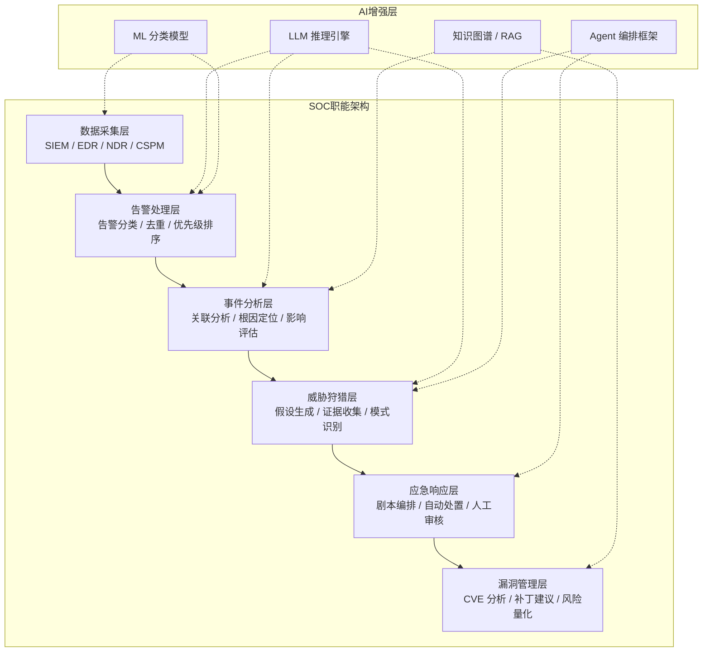
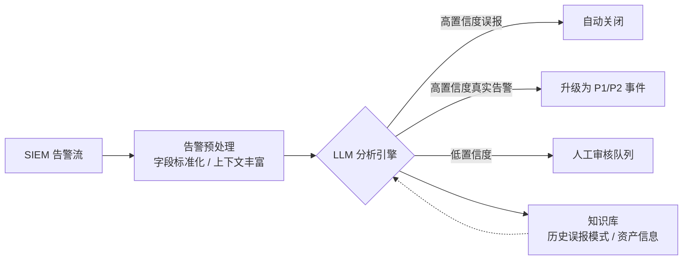

## 传统安全运营的结构性困境

现代企业的安全运营中心（SOC）正面临一场深刻的效率危机。随着企业 IT 基础设施的复杂度持续增长——混合云架构、微服务、IoT 设备、远程办公终端——安全团队每天需要处理的告警数量呈指数级增长。这种增长并非线性叠加，而是随着资产规模和攻击面的扩大呈超线性膨胀。

### 告警疲劳：被淹没的真正威胁

告警疲劳（Alert Fatigue）是 SOC 运营中最普遍也最危险的问题。安全分析师每天面对数以万计的安全告警，其中绝大多数是误报（False Positive）。根据 Ponemon Institute 2024 年的研究报告，典型企业 SOC 每天产生的安全告警中，**超过 70% 属于误报或重复告警**。这意味着分析师需要在大量噪音中筛选出真正有价值的安全信号，其工作模式更接近于在干草堆中寻找针头。

告警疲劳的直接后果是两类致命错误：

| 错误类型 | 描述 | 影响 |
|---------|------|------|
| **漏报（False Negative）** | 真正的攻击告警被淹没在噪音中，分析师未能及时响应 | 攻击者获得更长的驻留时间（Dwell Time），数据泄露风险大幅增加 |
| **误报消耗（False Positive Drain）** | 大量误报消耗分析师的时间和精力 | 对真正威胁的响应延迟，团队士气下降 |

### 人才短缺：供需失衡的鸿沟

网络安全人才短缺是一个持续加剧的全球性问题。ISC² 2024 年网络安全劳动力研究报告指出，全球网络安全人才缺口达到 **340 万人**，而中国市场的缺口约 **150 万**。一个成熟的 SOC 团队通常需要 8-15 名全职安全分析师才能维持 7×24 小时的运营覆盖，而大多数企业的实际配置远低于这一标准。

人才短缺意味着两个关键后果：一是现有团队超负荷运转，无法对每一条告警进行深入分析；二是关键岗位的离职导致经验断层，安全运营的知识沉淀高度依赖个人能力而非组织能力。

### 响应延迟：攻击者的速度优势

IBM X-Force 2024 年数据显示，从漏洞被利用到攻击者完成目标的平均时间已缩短至 **不到 72 小时**，但企业从检测到遏制的平均响应时间（MTTR）仍需 **197 天**。这一巨大的时间差距意味着攻击者在企业环境中拥有长达数月的自由操作窗口。传统的人工响应流程——告警确认、事件分类、影响评估、应急处置——每个环节都依赖人工判断和操作，速度远远落后于自动化攻击工具。

### 量化影响：安全运营的成本方程

传统安全运营的低效不仅是运营问题，更直接转化为财务损失。Ponemon Institute 对全球安全运营成本的调研表明：

- **误报处理成本**：每次误报的平均调查成本约为 **$1,470**，包含分析师时间、工具资源和流程开销
- **漏报损失**：每一次未被及时发现的安全事件平均造成 **$4.45M** 的财务损失（含业务中断、数据泄露赔偿、合规罚款）
- **人才成本**：一名经验丰富的安全分析师年薪约 **$120K-$180K**（中国市场约 **60-120 万 RMB**），加上招聘和培训成本，人才获取的总成本远高于薪资本身
- **工具冗余**：平均企业部署了 **45-70 种**安全工具，工具之间的数据孤岛问题进一步降低运营效率

面对这些结构性困境，AI 驱动的安全运营转型已不再是"锦上添花"，而是组织级安全能力建设的必然选择。

## AI 在安全运营中的应用全景

AI 在安全运营中的应用并非单一的技术替换，而是对 SOC 各职能环节的系统性增强。理解 AI 在安全运营中的定位，需要先明确 SOC 的核心职能架构：



从上图可以看出，AI 对安全运营的增强覆盖了从数据采集到漏洞管理的完整链路。根据应用类型和技术复杂度，可将 AI 在安全运营中的应用分为三个层次：

| 层次 | AI 能力 | 典型应用 | 技术栈 |
|------|---------|---------|-------|
| **感知层增强** | 异常检测、模式识别 | 网络流量异常检测、用户行为分析（UEBA） | 传统 ML（Isolation Forest、Autoencoder）、时序模型 |
| **认知层增强** | 语义理解、推理分析 | 告警摘要、事件关联分析、威胁情报解读 | LLM（GPT-4、Claude、开源模型）+ RAG |
| **行动层增强** | 自主决策、流程编排 | 自动化剧本执行、漏洞修复建议生成 | Agent 框架 + Tool Use + Human-in-the-Loop |

传统 ML 模型在**感知层**已有成熟的应用（如 UEBA、网络异常检测），本文聚焦于 LLM 和 Agent 技术在**认知层**和**行动层**的突破性应用——这些是当前 AI 安全运营最具变革性的方向。

## 智能告警分析：从噪音过滤到优先级排序

智能告警分析是 AI 赋能安全运营的最直接切入点。其核心目标是解决告警疲劳问题：通过 LLM 的语义理解能力，对原始告警进行自动化过滤、分类和优先级排序，将分析师的注意力集中在真正高风险的事件上。

### LLM 驱动的误报过滤架构

传统的误报过滤依赖基于规则的白名单或简单的统计阈值，误判率高且难以适应环境变化。LLM 通过理解告警的完整上下文——包括告警描述、关联资产信息、历史处置记录——可以做出更接近人类分析师的判断。



### 智能告警分析系统实现

以下是一个基于 LLM 的智能告警分析系统的核心实现。该系统接收来自 SIEM 的告警数据，通过 Prompt Engineering 引导 LLM 进行结构化分析，并输出标准化的分析结果：

```python
import json
from dataclasses import dataclass
from enum import Enum
from openai import OpenAI


class AlertSeverity(Enum):
    CRITICAL = "critical"
    HIGH = "high"
    MEDIUM = "medium"
    LOW = "low"
    INFO = "info"


class Verdict(Enum):
    TRUE_POSITIVE = "true_positive"
    FALSE_POSITIVE = "false_positive"
    NEEDS_INVESTIGATION = "needs_investigation"


@dataclass
class AlertAnalysis:
    verdict: Verdict
    severity: AlertSeverity
    confidence: float
    summary: str
    recommended_actions: list[str]
    false_positive_reason: str | None


ALERT_ANALYSIS_SYSTEM_PROMPT = """你是一位资深安全运营分析师，专注于告警分类与优先级评估