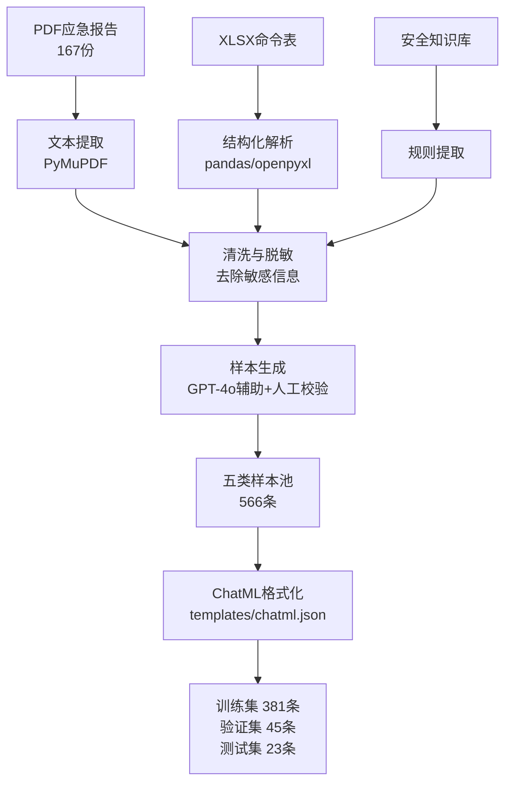
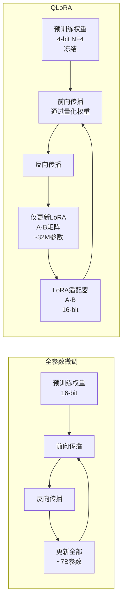

# 应急响应大模型微调：基于 Qwen2.5-7B 的 QLoRA 训练实践

应急响应（Incident Response）是安全运营中最具时间压力的场景之一。从收到告警到完成根因分析，黄金窗口往往以小时计。通用大模型虽然知识面广，但在应急场景中存在三个显著问题：输出内容不贴合安全团队的 SOP 和报告模板，对 ATT&CK 框架和取证工具的理解深度不够，以及推理过程中夹杂大量无关表述拖慢响应速度。

针对这些痛点，本实践基于 Qwen2.5-7B-Instruct 基座模型，采用 QLoRA 微调方法，使用 449 条高质量应急响应指令数据在单张 RTX 4090 上完成训练。本文将从数据工程、训练方案、配置分析与评估验证四个维度完整还原这一过程。

---

## 1. 数据工程：从原始文档到指令数据集

微调模型的效果上限由数据质量决定。本实践的数据构建涵盖三个原始来源和五类样本类型，经过多阶段清洗与格式化，最终产出 ChatML 格式的高质量指令数据集。

### 1.1 原始数据来源

数据原料来自真实应急响应工作流的三个渠道：

- **应急响应报告（PDF）**：共 167 份，包括 142 份典型应急案例报告和 25 份日常应急记录。覆盖挖矿木马、勒索病毒、Webshell 攻击、钓鱼邮件、异常流量、黑链植入六类主流安全事件类型。每份报告包含事件概述、取证数据、攻击链还原、根因分析与处置建议等完整闭环信息。
- **取证命令表（XLSX）**：78 条取证项目记录，附带 68 组 QA 问答对和 2227 条具体取证命令，覆盖 Windows 和 Linux 双平台的主流取证场景（进程分析、网络连接、文件系统、日志审计、内存分析等）。
- **安全知识库**：安全团队沉淀的取证 SOP、MITRE ATT&CK 战术技术映射表、以及日常应急问答积累。

### 1.2 数据流水线架构

数据从原始文档到训练样本的转换流程如下：



每个环节的设计要点：

- **文本提取**：使用 PyMuPDF 从 PDF 中提取正文，针对双栏排版和不规范标题做后处理纠正
- **脱敏处理**：正则匹配 + 实体识别，去除内网 IP、真实域名、个人姓名、账号密码等敏感信息
- **样本生成**：先由 GPT-4o 根据原始材料生成候选 QA 对，再由资深安全工程师逐条审核修正

### 1.3 五类样本构成

最终数据集 449 条样本按任务类型分为五类，覆盖应急响应分析师的核心工作场景：

| 样本类型 | 数量 | 输入示例 | 输出示例 |
| :--- | :--- | :--- | :--- |
| 事件分类 | 167 | 事件描述：服务器 CPU 700%，发现 miner.exe 连接矿池 | 挖矿木马事件 |
| 取证知识 QA | 207 | Windows 中如何查看近期创建的用户账号 | net user; Get-LocalUser; 注册表 SAM 分析 |
| 命令推荐 | 78 | 怀疑进程被 rootkit 隐藏，如何检测？ | chkrootkit; rkhunter; 对比 /proc 与 syscall |
| 命令 QA | 68 | `wmic process get` 的参数含义是什么？ | 解释 name、processid、executablepath 等字段 |
| 证据分析 | 46 | 日志片段 + 问询，判断是否为真实攻击 | 攻击链还原 + 可信度判定 |

### 1.4 ChatML 格式规范

所有样本统一使用 ChatML 模板封装，确保与 Transformers 的 chat_template 无缝兼容：

```json
{
  "messages": [
    {
      "role": "system",
      "content": "你是一名资深应急响应分析师，精通Windows和Linux取证分析、攻击链还原、根因研判与处置建议。请基于给定的上下文，给出专业、准确、可落地的回答。"
    },
    {
      "role": "user",
      "content": "Windows事件日志中Event ID 4625大量出现，且来源IP为境外地址，可能是什么情况？"
    },
    {
      "role": "assistant",
      "content": "Event ID 4625表示登录失败。大量来自境外IP的4625事件高度疑似暴力破解攻击（Brute Force）。建议：1) 核查该IP是否在威胁情报库中命中；2) 检查目标账号是否存在登录成功记录（Event ID 4624）；3) 若确认攻击，立即在边界防火墙上封锁该IP段，并为涉事账号启用MFA。"
    }
  ]
}
```

---

## 2. QLoRA 训练方案设计

### 2.1 为什么选择 QLoRA

在训练方案选型时，需要权衡三个约束条件：

- **硬件限制**：单张 RTX 4090 24GB，全参数微调 7B 模型需要约 100-120GB 显存，不可行
- **效果要求**：输出需要贴合应急领域的专业格式，Prompt Engineering 无法满足
- **部署约束**：LoRA 权重体积小（约 16-32MB），便于版本管理和热切换

QLoRA（Quantized Low-Rank Adaptation）在 LoRA 的基础上增加了 4-bit NormalFloat（NF4）量化，将基座模型的权重从 16-bit 压缩到 4-bit，显存占用降低约 4 倍。这使得原本需要 48GB 才能微调的 7B 模型，在单张 24GB 消费级显卡上即可完成训练。



全参数微调更新全部 7B 参数，QLoRA 仅更新约 3200 万个参数（0.045%），同时基座权重经过 NF4 量化后显存占用从 ~14GB 降至 ~4GB，为 LoRA 适配器和优化器状态留出了充裕空间。

### 2.2 LoRA 配置策略

LoRA 的核心思路是在冻结的预训练权重旁插入低秩分解矩阵，用 `A·B` 的乘积模拟权重更新量。关键超参数的选择依据如下：

- **r（秩）设为 16**：这是投入产出比最高的配置。r=8 在某些任务上表达能力不足，r=32 以上收益递减且训练参数翻倍。r=16 在 7B 规模模型上平衡了适配能力和收敛速度。
- **alpha 设为 32**：缩放因子 alpha/r = 2，这是 LoRA 论文推荐的默认比例，在不改变学习率调优习惯的前提下提供稳定的更新幅度。
- **dropout 设为 0.05**：适度正则化防止过拟合。应急数据集只有 381 条训练样本，dropout 过低容易在小数据上过拟合，过高则影响适配器的表达能力。
- **目标模块设为全部线性层**：这是 QLoRA 论文（Dettmers et al., 2023）的推荐做法。相比仅微调 attention 部分的 Q 和 V 矩阵，覆盖全部线性层能为模型提供更多可调整的自由度，尤其适合领域知识迁移这种需要较大更新量的任务。

### 2.3 训练超参数全景

| 参数 | 值 | 选择依据 |
| :--- | :--- | :--- |
| 基座模