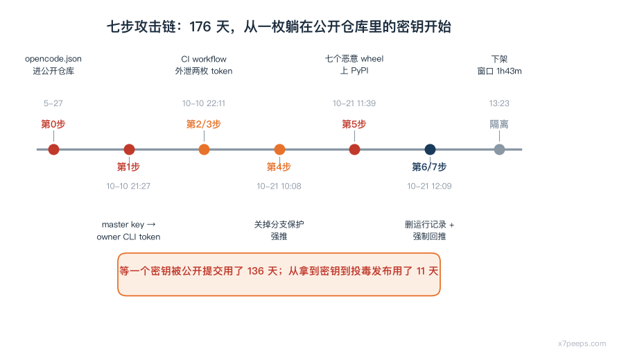
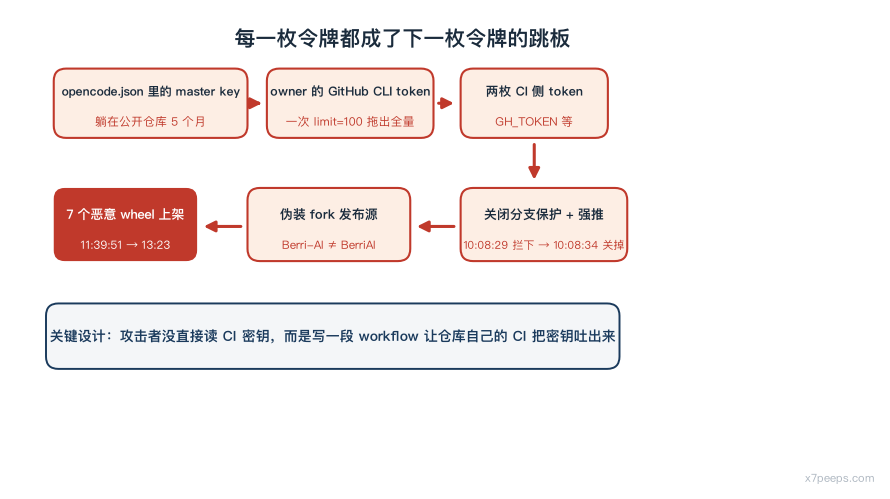
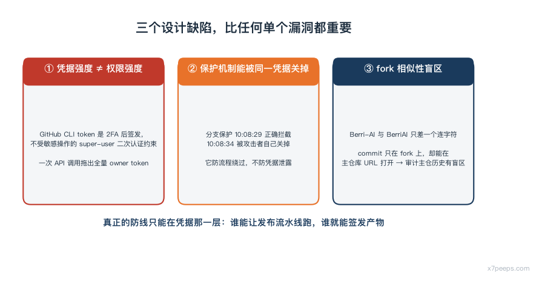

# LiteLLM 1.107.0 投毒：两小时、七步、三个令牌

2026 年 10 月 21 日 11:39:51 UTC，PyPI 上出现了七个名为 `litellm==1.107.0` 的 wheel。到 13:23 前后，这些包被隔离下线，窗口期约一小时四十三分钟。在这两个小时里，任何执行 `pip install litellm` 而没有锁定版本、或者在同一个时间窗拉取过 `litellm/litellm:latest` 镜像的人，拿到的都不是官方构建产物——里面塞着会窃取凭据并加载远程代码执行工具的编译后恶意代码。

LiteLLM 是 LLM 网关层：它替应用转发请求到 Claude、GPT、Gemini、本地模型，负责路由、计费、密钥托管和用量统计。这个位置意味着它同时握着两类最值钱的东西——**下游用户的全部 API 密钥，以及上游多个供应商的调用凭据**。所以当它被投毒时，受影响的不只是"装了坏包的人"，而是所有把它放在生产路径上的团队。

这件事值得写，不是因为"又一个供应链攻击"，而是因为它的攻击链公开得异常完整：厂商先后发了两篇报告，第一篇是事故通报，第二篇是逐分钟级别的根因分析，时间线精确到秒，牵涉的每一个令牌、每一次越权、每一个 IoC 都列了出来。更少见的是，**第二篇报告明确推翻了自己第一篇里的一个关键判断**。这份自我修正本身，就是这类事故里最稀缺的教学材料。

## 一份报告推翻了自己的哪句话

第一篇通报写于 10 月 21 日 18:20 UTC，里面有一句推测：攻击者拿到的 GitHub CLI OAuth token，很可能是被 Claude Code 之类的工具写进了响应体，而这些响应体记录在了 LiteLLM 的请求日志里。

第二篇根因分析写于 10 月 23 日 21:00 UTC，直接否掉了这个方向：

> Our first post suspected the tokens were taken from the logs of an internal LiteLLM deployment. The request logs show the first token came from a different service, described in step 1.

也就是说：token 不是从网关日志里捞的，是从一个独立的、内部 alpha 阶段的平台服务里拿的。两篇报告只隔了两天，结论却完全换了一条路径。

这不是吹毛求疵。第一篇里"日志泄露"这个说法会让防守方把注意力放在"清洗日志里的密钥"上——而真正要修的是五月就提交到公开仓库的那份配置文件。同一个事故，第一版描述引出的排查方向和第二版完全不同。

## 攻击链：七步，每一步都在用上一枚令牌

厂商在第二篇报告里给了一张按分钟排序的表，把整条链拆成七步。核心结构如下。

**第 0 步，5 月 27 日**：一个叫 `opencode.json` 的配置文件被提交进公开仓库 `LiteLLM-Labs/lite-harness`，里面带着内部 Agent Platform 的 master key。这一步持续了近五个月没被发现。攻击者不是从一个漏洞进来的，是从一个一直躺在公开仓库里的密钥进来的。

**第 1 步，10 月 10 日 21:13 至 21:28**：攻击者从 `69.48.229.143` 用 master key 调用 Agent Platform API。21:27:10，一个 `GET /api/v1/managed_agents/agents?limit=100` 请求返回了所有托管 agent 的配置，里面包含两名 GitHub 组织 owner 之一的 GitHub CLI OAuth token。至此攻击者拿到了组织级权限。

厂商在这里写了一句关键的技术事实：**GitHub CLI 的 token 是 2FA 之后签发的，不受 GitHub 针对敏感组织操作的 "super-user" 二次认证流程约束。** 换句话说，这种凭据在设计上的再验证强度，低于它实际拥有的权限。

**第 2、3 步，10 月 10 日 22:11 至 22:12**：攻击者用 owner 的 token 把两个一次性分支推进仓库——`ci-tmp-a351cc` 和 `ci-tmp-be33e9`。分支上的 workflow 把 CI 环境里的密钥发到攻击者控制的 `webhook.site` 端点。22:11:45 那次带走了 `GH_TOKEN`（第二名维护者的 token），24 秒后的另一次带走了 `RELEASE_PLEASE_TOKEN`（第三名维护者的 token）。两次运行记录随后都被删除。

这一步是整条链里最值得学习的设计：**攻击者没有直接读 CI 密钥，而是让仓库自己的 CI 把密钥吐出来。** CI 系统本来就有权限读这些 secret，攻击者只需要写一段 workflow 让它替自己读。事后清理运行记录的动作，也是同一枚 token 做的。

**第 4 步，10 月 21 日 10:08**：攻击者向私有仓库 `BerriAI/project-releaser` 的 `main` 推送提交 `9cf97e9`（提交信息 "ci: release from a fork source repository"），意图让发布工作流改从一个 fork 仓库取源码。用第二名维护者的 token 推送时，10:08:29 被分支保护拒绝——该分支要求走 PR、两个通过的检查、以及 codeowner 批准。五秒后，10:08:34，攻击者用 owner 的 token **直接关掉了分支保护**再强推，成功。

**第 5 步，10 月 21 日 10:46 至 11:46**：10:46:39 攻击者以 owner 身份调度 staging workflow，源码指向一个形似组织 `Berri-AI/litellm`（注意与真实的 `BerriAI` 差一个连字符）的 fork，commit 为 `20535d8f`。11:08:09 staging 跑完，11:08:53 生产发布流水线启动。11:11:18，第二名维护者的 token 从 `199.91.221.39` 批准了生产环境门禁。11:39:51 起，七个恶意 wheel 上架 PyPI；11:46:56，Docker Hub 与 GHCR 镜像发布。

**第 6、7 步，11:53 至 12:24**：第三名维护者的 token 删掉了生产和 staging 的运行记录；12:09:38 owner 的 token 推送 revert 提交 `285fbdc5`，12:24:52 把 `main` 强制推回 `d687b69`——两次都绕过了分支保护和 force-push 限制。

整条链的时间跨度是 **5 月 27 日到 10 月 21 日，147 天**。攻击者用 136 天等一个密钥被公开提交并被发现后的窗口期，然后用 11 天完成从一枚 master key 到投毒发布的全部准备。

## 三个设计缺陷，比任何单个漏洞都重要

把上面七步摊开看，能提炼出三类可以复用到自己环境里的问题。

**第一类：凭据的强度和它的权限不匹配。** 一次 API 调用返回了全量组织 owner 的 CLI token（`limit=100` 就把整个托管 agent 列表连同凭据一起拖了出来）；一次 CI 运行把六个 secret 全部外发；一次 push 就能关掉分支保护。GitHub CLI token 的 2FA 后签发特性意味着这类凭据绕过了 GitHub 自己为高危操作准备的二次确认环节——**当凭据能做的事比它的再验证强度大时，多因素认证只是在验证"登录"而不是验证"操作"。**

**第二类：保护机制可以被同一枚凭据关闭。** 分支保护在 10:08:29 正确拦住了攻击者，10:08:34 就被关掉了。这意味着分支保护在对抗"持有 owner token 的攻击者"时几乎不产生额外阻力——**它防的是流程绕过，不是凭据泄露。** 真正的防线只能在凭据本身那一层：谁能让发布流水线跑，谁就能签发产物。

**第三类：fork 的相似性。** 攻击者用的源仓库组织名是 `Berri-AI`，真实的是 `BerriAI`。厂商报告里写明了一个反直觉的细节：commit `20535d8f` 只存在于攻击者的 fork 上，但它在 `github.com/BerriAI/litellm/commit/20535d8f` 也能打开——因为 GitHub 会把 fork 的 commit 通过被 fork 出来的源仓库提供。这意味着**审计"提交是否在主仓库历史里"这件事本身有盲区**，只要发布流程允许指定外部源仓库，就必须额外校验源的身份。

## 现在的受害者该做什么

厂商在第一篇通报里列了受影响范围，边界相当明确：

- PyPI 的 `litellm==1.107.0`，七个 wheel，存活窗口 11:39:51 至 13:23 UTC；
- Docker Hub 的 `v1.107.0`、`latest`、`main-latest`、`main-stable`，指向恶意 image index `sha256:1bbcb1443bc962e45f5aad53fe3d2c30600e0379715fb6c664cdd3ac126c339e`，窗口 11:46:56 至 14:20 UTC；
- GHCR 同样四个 tag，从 11:46:56 UTC 起指向被污染的镜像索引，至迟 13:51 UTC 被下线。

官方 GitHub 上的 `v1.107.0` 源码 tag 不含恶意文件——**被污染的是构建产物，不是源码。** 私有企业版发布未受影响。

由此可以推出一条很实际的判定规则：**任何在那两个多小时的窗口里拉过 `latest` 或 `main-latest` 镜像的环境都算受影响，哪怕从没想过要用 1.107.0 这个版本。** 浮动 tag 的存在，让"我没指定版本所以我安全"这个假设直接失效。这一条对所有用浮动 tag 的镜像依赖都成立，不限于这个项目。

处理顺序上，优先级最高的不是卸载重装，而是**轮换凭据**。网关层持有的是所有下游用户的 API key，恶意代码的功能被描述为窃取凭据并加载 RCE 工具，所以凡是那台机器能读到的秘密，都按已泄露处理。厂商在事后直接进入了"假定组织内每一个 token、key、认证器都已被外泄"的运行模式，这是合理的默认。

## 从这条链上能抄走的几条

面向自己维护 CI/CD 流水线的团队，这起事故里有几条是能直接落地的：

**发布凭据不要用长期 OAuth token。** 换成 OIDC 之类的短期、绑定单一工作流的身份，它在流水线之外的存活时间足够短。厂商这次的整个第 5 步，依赖的就是一枚能长期复用的 token。

**给"改发布流程"这件事单独加一道关。** 本次攻击的高价值动作不是"发布坏包"，而是"把发布源从主仓库改到别处"。这类改动如果需要独立于发布凭据的第二个人工确认或另一套凭据，成本会陡然上升。

**审计日志里的 token 哈希要能串起来。** 厂商这次能做到时间线级别的追责，靠的是 GitHub 审计日志记录了每个操作背后 token 的哈希，且 `GH_TOKEN` 的哈希与第 5 步批准发布的那枚 token 哈希一致。没有这层关联，攻击链就只能靠时间相近性去猜。

**把"公开仓库里提交过配置"当成一次完整的安全事件来处理。** 这次的起点是一个五个月前的 `opencode.json` 提交。密钥扫描工具如果当时扫到了这个仓库并且触发了轮换，整条链在第 0 步就断了。凭据一旦进过版本历史，就应当假定已泄露并轮换，而不是"删掉文件就算完"。

**清理运行记录不会清除痕迹。** 攻击者在恶意包发布后约 7 分钟内连续删掉了生产和 staging 两条 workflow 运行记录，但厂商依然复原了完整时间线——因为 workflow 的运行记录删了，GitHub 审计日志里的动作记录还在。

## 边界

本文基于厂商两篇公开报告（10 月 21 日事故通报、10 月 23 日根因分析）整理，攻击链细节与时间线均出自后者；文中未做独立复现，也未验证各 IoC 的当前有效性。第三方安全厂商对该事件另有独立分析，其部分数字口径与厂商报告不同，本文不引用未经交叉确认的第三方统计。

关于泄露范围，厂商在第一篇通报里同时标注了那篇报告写作时"部分假设和判断后来被发现不准确或不完整"，并保留了原始文字作为调查记录。第二篇报告才是当前厂商认定的完整时间线。

*本文面向授权安全研究与防御建设。未经授权对任何系统实施文中技术属违法行为。*

## 参考

1. LiteLLM 官方事故通报（2026-10-21 18:20 UTC）——七个恶意 wheel 上架与隔离窗口、受影响版本与镜像 tag 清单、恶意 image index 摘要值、源码 tag 未受污染的说明；文中"第一版推测 token 来自网关日志"即出自该文并已被第二篇推翻。快照：`sources/litellm_incident.txt`
2. LiteLLM 官方根因分析（2026-10-23 21:00 UTC）——按分钟排序的七步攻击链表（第 0 步 `opencode.json` 进公开仓库、10-10 取得 owner CLI token、CI workflow 外泄 `GH_TOKEN` 与 `RELEASE_PLEASE_TOKEN`、关闭分支保护、`Berri-AI/litellm` 伪装 fork、删除运行记录与强制回推），以及明确推翻第一篇日志泄露推测的原文。快照：`sources/litellm_attack_chain.txt`
3. Socket 安全厂商对该投毒事件的独立分析。快照：`sources/socket_litellm_report.txt`

> 本文事实层以上述一手来源为限；「凭据强度与权限不匹配」「保护机制可被同一凭据关闭」「fork 相似性盲区」为作者归纳框架。
